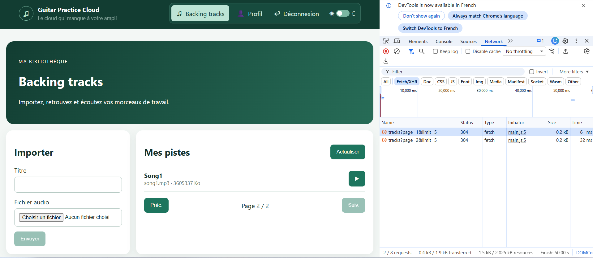

# Rapport d'usage de l'IA - TP1

Pour chaque mission, détailler et fournir des explications concernant : objectif; prompt principal; plan proposé par l'agent; vérifications réalisées par le binôme; erreurs ou propositions rejetées; fichiers effectivement modifiés; preuve de fonctionnement; ce que chaque membre sait maintenant expliquer sans l'agent.

pour la mission 0 du tp1 j'ai utilisé le prompt :  analyse de backend, je veux comprendre l'architecturen le workfow, les technologies et modules utilisées, comment est geré l'authentification, comment est fait l'upload de fichier est geré, comment les echanges avec la base de donnée est gere, genere des  diagrammes et des schema et met le resultat dans le backend/analyse.md

fais 10 critiques de ce code par ordre de priorité et que tu siggère des amelioration avenir en particulier sur les aspects securté et met à jour leficheir analyse.md
genere moi une barre d'outil et des icones sur les differents liens de l'entete

pour le lien profil e veux un bonhomme, backng tracks tu peux me mettre une icone de musique pour une icone connexion tu peux ajouter une icone de connexion et de deconnexion. Par la suite il faudra augmenter une fonctionnamité de deconnexion

toute la page sombre et non seulement la patie de stracks. et tu peux mettre une barre avec une icone soleil d'un coté et lune de l'autre afin de pouvoir basculer du mode sombre au mode par defaut

À propos, quel modèle utilisez-vous dans votre assistant IA ?
GitHub Copilot
 Comment savoir combien vous avez consommé de tokens ? 
    Dans l’interface Copilot, consultez les informations d’utilisation ou de quota de votre compte.
    Avec l’API, la réponse contient généralement un champ usage avec les tokens d’entrée et de sortie.
    Dans VS Code, les détails exacts dépendent de votre abonnement et du modèle utilisé.

 Qui peut vous conseiller quel est le meilleur modèle pour une tâche donnée ?

Questions : quelles sont les différentes routes du backend qui sont utilisées ? 
    /api/health :  pour verifier que l'Api fontionne
    /api/auth/login : pour connecter un utilisateur
    /api/tracks?page=1&limit=5 : lister les pistes audio ...
Soyez capables de répondre à la question : « où s'effectue la tâche “mise à jour du profil utilisateur” :  
    1-la page profil recupere le nom saisi puis appelle "AuthService.update()" dans profile-page.ts
    2- le service envoie PUT /api/users/me avec name puis met à jour le signal avec la reponse dans auth.service.ts
    3-la route express protégée par le middleware 'auth' recupere l'utilisateur depuis JWT et met à jour son nom avec Mongoose dans 'app.js'
    4- le modele 'User.js' definit notamment la validation du nom et la methode
Dans quels fichiers côté back et côté front ?
    coté Back :  app.js et user.js
    coté front : profile-page.ts et auth.service.ts 

    fait moi un schema annoté du flux de connexion et enregistre sous schema_fluxdeconnexion

 ## TP2
1 - pagination serveur : Oui, c’est une pagination côté serveur : quand tu changes de page, Angular demande GET /api/tracks?page=…&limit=5. L’API trie les pistes par date décroissante, puis ne renvoie que les cinq de la page demandée.

Le composant déclenche la requête dans tracks-page.ts; le service transmet les paramètres dans track.service.ts, et le backend applique le tri et la limite dans app.js.
Mission 2 : 
La capture Network de pagination est intégrée dans le bilan ci-dessous.
PAGINATION MONGOOSE : 
à partir de aggregate-paginate-v2 fait en sorte que le backend implemente la pagination à l'aide de ce plugin et mettre à jour le fichier API_CONTRACT.md et le frontend

## Bilan des travaux avec l'assistant — 2 octobre 2026

Cette section résume les demandes traitées pendant la séance. Une capture existante prouve la navigation entre les pages; une capture complémentaire de la réponse JSON reste à réaliser après vérification avec le backend modifié.

### TP1 — Connexion et schéma annoté

**Objectif :** diagnostiquer le message d'erreur du login et documenter le flux d'authentification.

**Prompts principaux :** « Pourquoi j'ai une erreur de connexion sur le login ? » et « Fais-moi un schéma annoté du flux de connexion et enregistre sous schema_fluxdeconnexion. »

**Résultat :** le frontend appelle `POST /api/auth/login`; le proxy Angular transmet `/api` au backend sur `localhost:3000`. Pendant le diagnostic, l'API était inaccessible. Après démarrage du backend, les logs ont confirmé la connexion à MongoDB Atlas et l'existence du compte de démonstration. Le message générique pouvait donc venir de l'API inaccessible, et pas seulement d'identifiants incorrects.

Le schéma documente la validation du formulaire, la recherche de l'utilisateur, la vérification bcrypt, l'émission et le stockage du JWT, la redirection et la protection des routes.

**Fichier produit :** [Schéma annoté du flux de connexion](schema_fluxdeconnexion.md).

**À savoir expliquer :** le backend vérifie le mot de passe par rapport à son hash; le frontend stocke le JWT et le transmet aux routes protégées.

### TP2 — Pagination de la bibliothèque

**Objectif :** afficher cinq pistes par page, naviguer entre les pages et effectuer une nouvelle requête HTTP à chaque changement.

**Prompts principaux :** vérifier la transmission de `page` et `limit` par `TrackService.list`, puis implémenter l'option avancée `aggregate-paginate-v2` et adapter l'API et le frontend.

**Décision retenue :** pagination côté serveur, limite de cinq pistes par défaut et boutons « Préc. » / « Suiv. ». Chaque changement de page demande des résultats au backend; Angular ne charge pas toutes les pistes pour les découper localement. Les pistes sont triées des plus récentes aux plus anciennes et restent filtrées par utilisateur connecté.

**Implémentation :** le nom publié du package est `mongoose-aggregate-paginate-v2`. Le plugin est attaché au schéma `Track` et utilisé dans la route des pistes. La réponse expose `docs`, `totalDocs`, `page`, `limit`, `totalPages`, `nextPage`, `prevPage`, `hasNextPage`, `hasPrevPage` et `pagingCounter`. Les champs privés `_id` et `storedName` ne sont pas renvoyés. Angular lit `docs` et `totalPages` et continue d'envoyer `page` et `limit`.

**Fichiers concernés :**

- [Service HTTP des pistes](frontend-starter/src/app/shared/services/track.service.ts)
- [Composant bibliothèque](frontend-starter/src/app/components/tracks-page/tracks-page.ts)
- [Modèle de réponse paginée](frontend-starter/src/app/shared/models/page.model.ts)
- [Modèle Mongoose Track](backend/src/models/Track.js)
- [Route backend des pistes](backend/src/app.js)
- [Dépendances backend](backend/package.json)
- [Tests API](backend/test/api.test.js)
- [Contrat HTTP](API_CONTRACT.md)

**Vérifications effectuées :** les tests backend passent (`3/3`), dont un test HTTP qui vérifie `page=2&limit=5`, les métadonnées retournées et le masquage de `storedName`. Ce test simule le résultat du plugin et ne vérifie donc pas une agrégation exécutée sur MongoDB Atlas. Le build Angular passe et aucun diagnostic TypeScript/JavaScript n'a été signalé.

**Preuve de navigation disponible :** la capture ci-dessous montre les requêtes `tracks?page=1&limit=5` et `tracks?page=2&limit=5`, ainsi que l'interface sur « Page 2 / 2 ». Elle prouve la navigation et la transmission des paramètres. Les requêtes visibles ont le statut `304`; la capture ne montre pas le corps JSON renvoyé par le plugin.

**Preuve complémentaire à réaliser :** après avoir lancé le backend modifié, cocher « Disable cache » dans DevTools, sélectionner la requête de la page 2, puis capturer l'onglet Response avec `docs`, `totalDocs` et `totalPages`.

**À savoir expliquer :** le composant demande la page au service, le service passe les paramètres HTTP, puis le backend exécute le pipeline et le plugin calcule les métadonnées. La première page contient les pistes les plus récentes.

### TP2 — Mission 3 : flux d’upload et de lecture audio

**Objectif :** repérer le parcours déjà fourni par le frontend et l’API, du choix du fichier jusqu’à sa lecture, sans réimplémenter ni modifier le contrat HTTP.

**Fichiers et méthodes concernés :**

- [Template de la bibliothèque](frontend-starter/src/app/components/tracks-page/tracks-page.html) : le champ `<input type="file">` déclenche `choose($event)` et accepte les fichiers audio via `accept="audio/*"`. Le lecteur `<audio>` reçoit ensuite `audioUrl()` avec `[src]`.
- [Composant bibliothèque](frontend-starter/src/app/components/tracks-page/tracks-page.ts) : `choose()` récupère le premier fichier sélectionné et le conserve dans `file`. `upload()` appelle le service. `play(track)` s’abonne à la réponse audio, révoque l’ancienne URL locale si elle existe, puis crée et stocke une nouvelle URL avec `URL.createObjectURL(blob)`.
- [Service HTTP des pistes](frontend-starter/src/app/shared/services/track.service.ts) : `upload()` construit le `FormData` avec exactement les champs `audio` et `title`, puis effectue `POST /api/tracks` en écoutant les événements de progression. `audio(id)` effectue `GET /api/tracks/:id/audio` avec `responseType: 'blob'`; `delete(id)` appelle `DELETE /api/tracks/:id`.
- [Intercepteur d’authentification](frontend-starter/src/app/shared/interceptors/auth.interceptor.ts) : quand le token est disponible, il ajoute automatiquement le JWT à la requête HTTP. La requête audio passe par `HttpClient`, donc elle passe aussi par cet intercepteur.
- [Routes backend des pistes](backend/src/app.js) : `POST /api/tracks` reçoit le multipart via `upload.single("audio")`, lit le titre dans `req.body.title` et enregistre le fichier et ses métadonnées. `GET /api/tracks/:id/audio` vérifie l’accès de l’utilisateur, définit le type MIME et envoie le fichier avec `res.sendFile`.

**Flux d’upload — composant → service → `HttpClient` → API :** l’utilisateur sélectionne un fichier dans le template; `choose()` le récupère et le stocke dans `file`. À l’action « Envoyer », `upload()` transmet le fichier et le titre au service (ou le nom du fichier si le titre est vide). Le service place ces valeurs dans `FormData` sous les clés `audio` et `title`, puis `HttpClient.post` envoie le multipart à `POST /api/tracks`. L’intercepteur ajoute le JWT. L’API traite le fichier et répond avec la piste créée; le composant vide alors le titre et le fichier sélectionné, revient à la première page et recharge la liste.

**Validation du fichier côté frontend :** `choose()` vérifie maintenant le type MIME contre les formats acceptés par l’API (`audio/mpeg`, `audio/wav`, `audio/x-wav`, `audio/ogg`, `audio/mp4`, `audio/x-m4a`) et refuse les fichiers de plus de 25 Mo. `upload()` vérifie aussi qu’un fichier a bien été sélectionné avant d’appeler le service. En cas de refus, le formulaire affiche une explication avec `role="alert"` et aucun upload n’est lancé. L’API garde les mêmes contrôles à la réception.

Cette vérification dans le navigateur donne un retour immédiat à l’utilisateur et évite un appel inutile. Elle ne remplace pas celle du backend : un utilisateur peut contourner le frontend ou fabriquer une requête HTTP; le serveur doit donc toujours vérifier lui-même le fichier avant de l’accepter.

**Interface pendant l’envoi :** auparavant, seul un texte « Envoi en cours… » apparaissait, sans progression mesurée. Désormais, `TrackService.upload()` utilise les événements HTTP et `reportProgress`; `uploadProgress` affiche le pourcentage transmis par le navigateur quand la taille totale est connue, ou une barre indéterminée dans le cas contraire. Le bouton et les champs sont désactivés pendant l’envoi et `upload()` ignore aussi les doubles soumissions. En cas d’erreur, le message fourni par l’API est affiché (ou un message de secours clair). En cas de succès, une confirmation est affichée, le formulaire est vidé, puis la première page est rechargée.

**Suppression et filtre :** chaque card propose une suppression qui demande d’abord confirmation, puis appelle `DELETE /api/tracks/:id`. En cas de succès, le lecteur associé est nettoyé si nécessaire et la première page est rechargée; le résultat est annoncé. Le filtre par titre est envoyé au backend avec `search`, qui effectue une recherche partielle insensible à la casse sur les pistes de l’utilisateur. Le backend traite la recherche comme une chaîne littérale pour éviter que les caractères saisis soient interprétés comme une expression régulière.

**Cards des pistes :** la liste est maintenant un ensemble de cards responsive et sémantique (`ul` / `li` / `article`). Chaque card présente un titre, le nom original, le format MIME, la taille dans une unité adaptée (o, Ko, Mo ou Go), la date d’ajout au format jour/mois/année et heure, ainsi que des actions « Lire » et « Supprimer » accessibles. Après clic sur « Lire », le lecteur audio s’affiche sous les informations de la card sélectionnée. Le son est récupéré à la demande et l’ancienne URL locale est révoquée avant son remplacement; il n’y a donc pas de téléchargement de tous les audios à l’affichage. Le format en grille s’adapte à la largeur disponible et garde des styles lisibles en mode sombre.

Le style des cards comprend maintenant un fond légèrement dégradé, une ombre discrète, des coins arrondis et un effet de survol. Les couleurs sont adaptées au mode sombre et les animations sont désactivées lorsque le système demande une réduction des mouvements.

**Nombre de cards par page :** la bibliothèque demande 5 pistes par page (`limit=5`). Le backend accepte cette valeur dans sa limite autorisée de 1 à 20.

**Date d’ajout des pistes :** la date `createdAt` est déjà renvoyée par le modèle public du backend et présente dans le modèle Angular. Chaque card l’affiche sous la forme `jj/MM/aaaa à hh:mm`, avec une balise `<time>` dont l’attribut `datetime` conserve la valeur complète.

**Flux de lecture — API → `Blob` → `ObjectURL` → lecteur audio :** quand l’utilisateur demande la lecture d’une piste, `play()` demande au service son contenu audio par identifiant. `HttpClient` récupère la réponse sous forme de `Blob`; à la réception, le composant révoque l’ancienne `ObjectURL` si elle existe, crée une URL locale avec `URL.createObjectURL(blob)` et la place dans le signal `audioUrl`. La liaison `[src]="audioUrl()"` affecte cette URL au lecteur `<audio>`, qui peut alors lire le Blob avec ses contrôles natifs.

**Pourquoi `Blob` et `ObjectURL` ?** `Blob` permet de récupérer les octets audio comme un objet binaire côté navigateur. `URL.createObjectURL(blob)` fournit au lecteur `<audio>` une URL locale temporaire pour lire ces données. L’URL est révoquée lorsqu’on change de piste ou quitte le composant afin de libérer les ressources associées.

**Explication simple du JWT et de Network :** l’intercepteur est comme un ajout automatique : pour les appels faits avec `HttpClient`, il met le jeton de connexion dans l’en-tête `Authorization`. Pour le vérifier, ouvrir les outils de développement du navigateur, choisir l’onglet **Network**, cliquer sur le bouton de lecture puis sélectionner la requête `GET /api/tracks/<id>/audio`. Dans **Headers** → **Request Headers**, on doit trouver `Authorization: Bearer …` si l’utilisateur est connecté.

**Gestion du cycle de vie constatée :** l’URL précédente est révoquée avant son remplacement et l’URL encore active est révoquée à la destruction du composant, afin de libérer les ressources associées.

**Vérification effectuée :** le fonctionnement de l’intercepteur et du parcours audio a été vérifié dans le code. Les étapes ci-dessus permettent de vérifier la présence du JWT dans **Network**; aucune capture de cette requête audio n’a été réalisée pendant la séance.

### Vérifications et limites

- Le backend a été démarré lors du diagnostic initial et s'est alors connecté à Atlas.
- La vérification de la nouvelle pagination contre MongoDB Atlas reste à réaliser par le binôme; les tests automatisés utilisent une réponse simulée du plugin.
- L'installation npm a signalé une vulnérabilité modérée dans l'arbre de dépendances. Elle n'a pas été corrigée dans cette mission; examiner `npm audit` séparément.

### Réponses aux questions sur mémoire, buffering et streaming

**Le backend envoie-t-il le fichier entier en mémoire ou peut-il l’envoyer progressivement depuis le disque ?**  
La route `GET /api/tracks/:id/audio` utilise `res.sendFile(audioPath)` dans [backend/src/app.js](backend/src/app.js). Elle ne lit pas explicitement tout le fichier dans un buffer JavaScript avant de répondre; Express peut envoyer le fichier progressivement depuis le disque. La route ne met donc pas volontairement tout le fichier en mémoire applicative. Le moment où le navigateur peut commencer à lire dépend aussi de la réponse HTTP et de son comportement de buffering.

**Avec `HttpClient` et `responseType: "blob"`, à quel moment le composant reçoit-il généralement le fichier ?**  
Dans [track.service.ts](frontend-starter/src/app/shared/services/track.service.ts), la réponse audio est demandée comme un `Blob`. Dans [tracks-page.ts](frontend-starter/src/app/components/tracks-page/tracks-page.ts), le composant ne reçoit ce Blob que dans `next` après la réception complète de la réponse par `HttpClient`. Il crée ensuite l’URL locale et affiche le lecteur. Ce parcours ne donne donc généralement pas au lecteur l’accès au début du fichier pendant que le reste est encore téléchargé.

**Si la bibliothèque contient 100 morceaux, les 100 fichiers audio sont-ils chargés en mémoire dès l’affichage de la liste ?**  
Non. La liste récupère les métadonnées avec `TrackService.list()`. Le contenu audio est demandé séparément par `TrackService.audio(id)` uniquement quand on clique sur « Lire ». La card sélectionnée affiche alors le Blob chargé. Le code ne demande donc pas les 100 fichiers audio à l’affichage de la bibliothèque.

**Quelle différence y aurait-il avec 100 éléments `<audio>` utilisant directement une URL HTTP ?**  
Chaque lecteur aurait une URL distante et le navigateur déciderait quand demander des données selon ses besoins et son réglage `preload`; cela ne signifie pas forcément que les 100 fichiers entiers seraient immédiatement téléchargés. Toutefois, de nombreux lecteurs pourraient déclencher des requêtes ou du préchargement et consommer plus de réseau et de ressources. La lecture directe pourrait aussi commencer pendant la réception progressive des données, contrairement au parcours `Blob` utilisé ici. Enfin, l’URL directe ne bénéficie pas de l’intercepteur Angular qui ajoute le JWT; la route audio étant protégée, une telle requête ne serait pas authentifiée sans mécanisme adapté.

## Journal des demandes récentes

Pour chaque nouvelle demande, la requête est reformulée en objectif concret, puis le résultat est consigné avec les fichiers modifiés, la méthode suivie et les vérifications effectuées. Pour une question sans modification de code, noter la question reformulée et la réponse apportée.

### Mode sombre sur toute la page

**Demande reformulée :** étendre le fond et la palette du mode sombre à toute la fenêtre, y compris les espaces extérieurs au contenu, plutôt que de limiter le thème à certaines sections.

**Résultat :** les styles globaux définissent une hauteur minimale pour `html` et `body`, un fond sombre pour `body.dark-mode` et une largeur complète pour `.app-shell.dark-mode`. Le composant racine applique la classe sombre au corps et conserve la classe sur l’enveloppe de l’application.

**Fichier modifié :** [frontend-starter/src/styles.css](frontend-starter/src/styles.css).

**Vérification :** la compilation Angular (`npm run build`) a réussi.

### Consigner les demandes et leurs résultats

**Demande reformulée :** reformuler chaque nouvelle requête de façon claire et concrète, puis tenir à jour ce rapport avec chaque demande ou question, les résultats obtenus, les fichiers modifiés et la démarche suivie.

**Résultat :** cette règle de suivi est ajoutée au rapport et le changement de mode sombre est documenté comme première entrée de ce journal. Les prochaines demandes et questions seront consignées dans cette section avec leur résultat.

**Fichier modifié :** [RAPPORT_IA_MODELE.md](RAPPORT_IA_MODELE.md).

### Harmoniser le mode sombre sur toutes les pages

**Demande reformulée :** rendre le mode sombre cohérent et lisible sur toutes les pages et tous les contrôles de l’application, et pas uniquement sur le fond général et les cartes de pistes.

**Résultat :** les règles globales du thème sombre couvrent maintenant l’en-tête et sa barre d’outils, les panneaux, les titres et textes, les champs de saisie (y compris zones de texte et listes), les liens, les boutons, leurs états de survol et de focus, ainsi que les messages d’erreur. Le fond et la couleur des contrôles natifs sont harmonisés pour le thème sombre; les styles dédiés aux cartes de pistes restent en place.

**Fichier modifié :** [frontend-starter/src/styles.css](frontend-starter/src/styles.css).

**Vérification :** la compilation Angular (`npm run build`) a réussi et aucun problème n’est signalé dans `styles.css`.

### Afficher deux pistes par page

**Demande reformulée :** limiter à deux le nombre de pistes affichées sur chaque page de la bibliothèque.

**Résultat à l’époque :** le composant et le service avaient été réglés à deux pistes par page. Ce réglage a depuis été remplacé par la demande suivante de cinq pistes par page.

**Fichiers modifiés :** [frontend-starter/src/app/components/tracks-page/tracks-page.ts](frontend-starter/src/app/components/tracks-page/tracks-page.ts), [frontend-starter/src/app/shared/services/track.service.ts](frontend-starter/src/app/shared/services/track.service.ts), [API_CONTRACT.md](API_CONTRACT.md) et [RAPPORT_IA_MODELE.md](RAPPORT_IA_MODELE.md).

**Vérification à l’époque :** la compilation Angular (`npm run build`) avait réussi et aucun problème n’était signalé dans le composant ou le service.

### Présenter les pistes horizontalement et afficher cinq par page

**Demande reformulée :** présenter chaque piste sous forme de carte horizontale, avec la couverture à gauche et les métadonnées/actions à droite, et afficher cinq pistes par page.

**Résultat :** la liste utilise une seule colonne de cartes horizontales. Sur petit écran, la couverture et la zone de texte se réduisent et les métadonnées passent sur deux colonnes tout en gardant une disposition horizontale. Le composant et le service demandent maintenant cinq pistes (`limit=5`); le contrat API a été actualisé.

**Fichiers modifiés :** [frontend-starter/src/app/components/tracks-page/tracks-page.html](frontend-starter/src/app/components/tracks-page/tracks-page.html), [frontend-starter/src/app/components/tracks-page/tracks-page.css](frontend-starter/src/app/components/tracks-page/tracks-page.css), [frontend-starter/src/app/components/tracks-page/tracks-page.ts](frontend-starter/src/app/components/tracks-page/tracks-page.ts), [frontend-starter/src/app/shared/services/track.service.ts](frontend-starter/src/app/shared/services/track.service.ts), [API_CONTRACT.md](API_CONTRACT.md) et [RAPPORT_IA_MODELE.md](RAPPORT_IA_MODELE.md).

**Vérification :** la compilation Angular (`npm run build`) réussit et aucun problème n’est signalé dans le template, les styles, le composant ou le service.

### Réduire les cartes et centrer les boutons

**Demande reformulée :** réduire l’encombrement des cartes horizontales et centrer les boutons Lire et Supprimer avec un alignement uniforme.

**Résultat :** la largeur de la couverture, l’espacement et le remplissage de la carte ont été diminués. Les boutons sont centrés, de largeur cohérente et restent côte à côte sur petit écran lorsque l’espace le permet; le lecteur audio est centré sous les actions.

**Fichier modifié :** [frontend-starter/src/app/components/tracks-page/tracks-page.css](frontend-starter/src/app/components/tracks-page/tracks-page.css).

**Vérification :** la compilation Angular (`npm run build`) réussit et aucun problème n’est signalé dans le template ni dans la feuille de styles.

### Réduire la hauteur du panneau Importer

**Demande reformulée :** diminuer la hauteur du panneau d’importation en réduisant ses marges, ses espacements et le remplissage des champs, sans changer le formulaire ni ses états d’upload.

**Résultat :** une classe propre au panneau Importer applique un padding plus compact, resserre l’espacement entre les champs et réduit légèrement la hauteur des entrées. Les messages d’état et la progression restent affichés normalement.

**Fichiers modifiés :** [frontend-starter/src/app/components/tracks-page/tracks-page.html](frontend-starter/src/app/components/tracks-page/tracks-page.html) et [frontend-starter/src/app/components/tracks-page/tracks-page.css](frontend-starter/src/app/components/tracks-page/tracks-page.css).

**Vérification :** la compilation Angular (`npm run build`) réussit et aucun problème n’est signalé dans le template ni dans la feuille de styles.

### Empêcher le panneau Importer de s’étirer

**Demande reformulée :** dans la grille de la bibliothèque, conserver le panneau « Importer » à la hauteur de son contenu au lieu de l’étirer à la hauteur de la liste des pistes.

**Résultat :** la grille aligne maintenant ses éléments au début de la rangée (`align-items: start`). Le panneau « Importer » ne s’étire plus avec le panneau voisin; aucun défilement interne n’a été ajouté.

**Fichier modifié :** [frontend-starter/src/styles.css](frontend-starter/src/styles.css).

**Vérification :** la compilation Angular (`npm run build`) réussit et aucun problème n’est signalé dans `styles.css`.

**Pourquoi l’URL créée par `URL.createObjectURL` doit-elle être révoquée ?**  
Cette URL locale garde une référence au Blob et aux ressources qu’il utilise. Quand on change de morceau ou que le composant est détruit, `URL.revokeObjectURL()` indique au navigateur que l’URL n’est plus nécessaire et permet de libérer ces ressources. Le composant révoque l’ancienne URL au remplacement et la dernière URL dans `ngOnDestroy()`.

# TP3
# Mission 6
pourquoi un upload avec progression ne se traite pas exactement comme une requête HTTP qui émet uniquement une réponse finale?
 Parce qu’un upload avec progression émet plusieurs événements pendant l’envoi, tandis qu’une requête classique ne fournit que sa réponse finale. On peut ainsi suivre l’avancement sans attendre la fin.

# Mission 7

## Exécution des tests et vérifications TP3 — 8 octobre 2026

**Demande reformulée :** suivre les consignes de `SUJET_ETUDIANT_TP3.md`, exécuter les tests automatisés frontend et backend ainsi que le build Angular, ajouter les tests frontend manquants et consigner les résultats observés.

### Tests frontend ajoutés

Le frontend ne contenait pas de tests de services ou de composants. Cinq tests ciblés ont été ajoutés, sans dépendre d’un backend ou de MongoDB :

| Fichier | Vérification | Résultat |
|---|---|---|
| `track.service.spec.ts` | `TrackService.list()` transmet l’URL, la méthode GET, `page`, `limit` et le filtre | Réussi |
| `track.service.spec.ts` | L’upload utilise POST multipart avec `audio`, `title` et la couverture facultative, et émet progression puis réponse finale | Réussi |
| `track.service.spec.ts` | L’erreur HTTP d’upload est propagée au souscripteur | Réussi |
| `tracks-page.spec.ts` | Le composant calcule le pourcentage, bloque une deuxième soumission et affiche l’erreur | Réussi |
| `tracks-page.spec.ts` | Le composant affiche le succès, vide le formulaire et recharge les pistes | Réussi |

**Commande :** `cd frontend-starter && npm test` (exécutée sous Windows avec `npm.cmd test`).  
**Résultat observé :** 2 fichiers de tests réussis, 5 tests réussis, 0 échec.

**Configuration des tests :** `jsdom` a été ajouté comme dépendance de développement pour fournir un environnement DOM. L’option `buildTarget` a été ajoutée à la cible Angular `test`, qui ne pouvait auparavant pas résoudre la configuration de build requise par `ng test`.

### Tests backend disponibles

**Commande :** `cd backend && npm test` (exécutée sous Windows avec `npm.cmd test`).  
**Résultat observé :** 4 tests réussis, 0 échec : état de santé sans MongoDB, schémas Mongoose, pagination HTTP avec résultat simulé, upload et lecture authentifiée d’une couverture ainsi que compatibilité de l’upload audio seul.

Le test de pagination remplace le plugin par un résultat simulé; il ne valide pas une agrégation exécutée sur Atlas. Les tests d’upload remplacent la création Mongoose et nettoient les fichiers de fixture générés.

### Build Angular

**Commande :** `cd frontend-starter && npm run build` (exécutée sous Windows avec `npm.cmd run build`).  
**Résultat observé :** build réussi après l’ajout des tests.

### Vérifications manuelles non réalisées

- Aucune capture Network d’une suppression ni d’un upload n’a été prise durant cette exécution; il reste à ouvrir l’application, confirmer une suppression et lancer un upload pour capturer ces requêtes.
- La console du navigateur n’a pas été inspectée pendant une session réelle. Les tests automatisés ne remplacent pas ce contrôle manuel.
- Les tests backend facultatifs `401`, JWT invalide, upload sans fichier/type refusé et autorisation inter-utilisateurs n’ont pas été ajoutés dans cette série.

### État des exigences TP3 non couvertes par ces tests

- La suppression et son actualisation sont présentes dans le frontend; aucun test frontend automatisé de suppression n’a été ajouté ici.
- Le sujet demande un composant SnackBar pour les retours de suppression. Le code actuel affiche ces retours dans la page avec des régions accessibles; ce n’est pas un SnackBar.
- Le contrôle de propriété de la suppression doit être confirmé côté backend par les tests d’autorisation dédiés ou une vérification manuelle; il n’est pas démontré par les cinq tests frontend ci-dessus.

**Fichiers modifiés pour cette vérification :** [frontend-starter/src/app/shared/services/track.service.spec.ts](frontend-starter/src/app/shared/services/track.service.spec.ts), [frontend-starter/src/app/components/tracks-page/tracks-page.spec.ts](frontend-starter/src/app/components/tracks-page/tracks-page.spec.ts), [frontend-starter/angular.json](frontend-starter/angular.json), [frontend-starter/package.json](frontend-starter/package.json), [frontend-starter/package-lock.json](frontend-starter/package-lock.json) et [RAPPORT_IA_MODELE.md](RAPPORT_IA_MODELE.md).

**Note dépendances :** après l’ajout de `jsdom`, npm a signalé 10 vulnérabilités dans l’arbre de dépendances (2 modérées, 5 élevées, 3 critiques). Elles n’ont pas été corrigées dans le cadre de cette vérification.

## Proposition Butterchurn + ISF — 8 octobre 2026

**Demande reformulée :** proposer un pipeline qui enchaîne le rendu Butterchurn avec des shaders ISF, permettre à terme l’ajout de shaders et de scripts, préparer une ressource ISF publique pour un essai ultérieur et définir des tests avant l’intégration.

**État du projet :** aucune dépendance ni implémentation Butterchurn/ISF n’a été trouvée dans le frontend. La demande est préparatoire : aucune bibliothèque ni aucun shader n’a été intégré à l’application.

**Ressource d’essai préparée :** le manifeste [test.butterchurn](test.butterchurn) contient le lien de démonstration Butterchurn et une URL brute, épinglée sur un commit, vers `badtv.fs`, shader ISF qui reçoit `inputImage` et expose plusieurs paramètres d’effet. L’URL brute a été récupérée avec succès pendant la recherche; elle sert le code source et n’est pas un aperçu interactif hébergé. Le shader contient une attribution à VIDVOX ainsi qu’une licence MIT embarquée; conserver les crédits et la licence si le shader est redistribué.

**Proposition d’architecture :** garder le flux audio authentifié existant, puis connecter l’élément `<audio>` en lecture à Web Audio et à Butterchurn. Butterchurn dessine sur un canvas WebGL hors écran; un moteur ISF reçoit cette image en entrée (`inputImage`), traite les effets dans l’ordre configuré et envoie l’image finale au canvas visible. Pour plusieurs effets, privilégier un contexte WebGL réutilisé avec des framebuffers ping-pong, plutôt que créer un contexte par effet. Vérifier les contraintes CORS si les shaders sont chargés depuis une URL distante; pour une intégration fiable, permettre l’import local de fichiers `.fs`, valider leurs métadonnées puis signaler les erreurs de compilation.

**Scripts proposés :** autoriser des séquences déclaratives JSON pour les changements de preset et les keyframes des paramètres (identifiant d’effet, nom de paramètre, valeur dans les bornes et temps). Éviter d’exécuter du JavaScript libre fourni par l’utilisateur dans le contexte de l’application.

**Tests proposés dans `test.butterchurn` :** parsing et présence de `inputImage`; gestion d’un shader invalide ou d’un échec de chargement; ordre du chaînage et passage de l’image entre les étapes; validation des bornes des paramètres; application temporisée des scripts déclaratifs; nettoyage des ressources WebGL/audio à l’arrêt; stabilité sans lecture audio, redimensionnement et perte du contexte WebGL. Ces tests restent des critères de test : il n’existe pas encore de pipeline pour les exécuter automatiquement.

**Fichiers modifiés :** [test.butterchurn](test.butterchurn) et [RAPPORT_IA_MODELE.md](RAPPORT_IA_MODELE.md).

**Vérification :** le fichier source ISF a été récupéré depuis l’URL distante épinglée et inspecté pour confirmer son en-tête ISF, `inputImage` et ses contrôles. Aucun build ni test d’intégration applicatif n’a été lancé, car le code de la fonctionnalité n’a pas encore été créé.

### État de l’intégration Butterchurn dans la playlist

**Question reformulée :** Butterchurn et le shader ISF préparé sont-ils déjà intégrés à la playlist et au lecteur de morceaux ?

**Réponse :** non. `test.butterchurn` ne contient qu’un plan d’essai, une URL de démonstration, une URL de shader et des critères de test. La playlist et le lecteur audio ne chargent ni Butterchurn ni ISF; aucune dépendance ou fonctionnalité visuelle n’a été ajoutée à l’application.

**Fichiers modifiés pour cette clarification :** [RAPPORT_IA_MODELE.md](RAPPORT_IA_MODELE.md).
