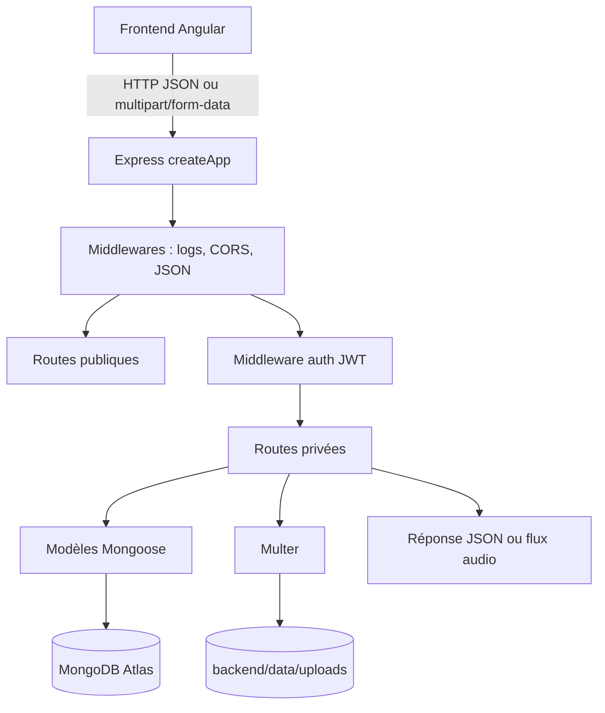
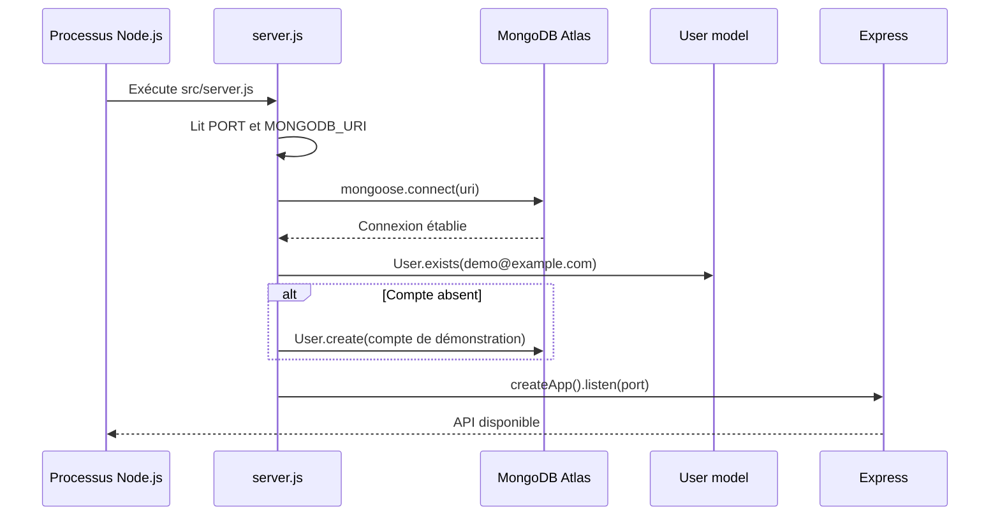
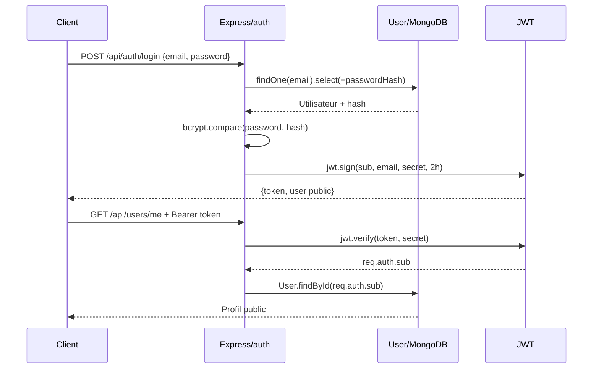
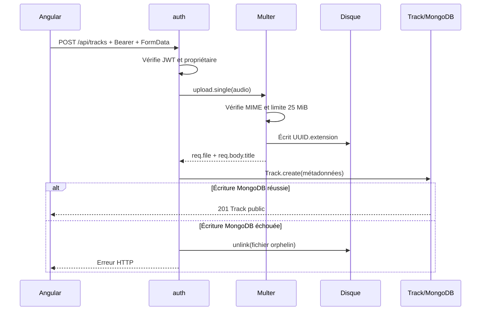
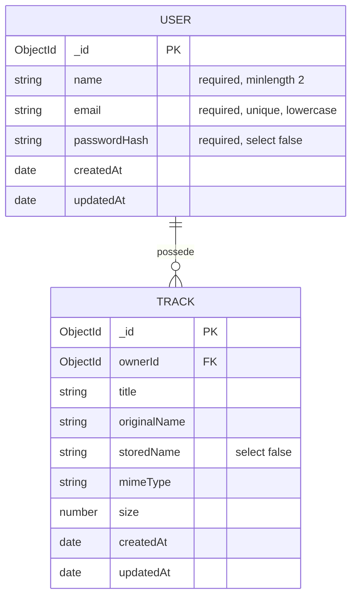

# Analyse du backend

## 1. Résumé de l’architecture

Le backend est une API REST Node.js exécutée avec Express. Il fournit les
routes consommées par l’application Angular et sépare deux types de
persistance :

- **MongoDB Atlas**, accessible avec Mongoose, conserve les utilisateurs et les
  métadonnées des pistes audio ;
- **le système de fichiers du serveur**, dans `backend/data/uploads/`, conserve
  les octets des fichiers audio.

L’application est volontairement simple : les routes, les middlewares et
une partie de la logique métier sont regroupés dans `src/app.js`. Les modèles
Mongoose sont dans `src/models/`. `src/server.js` est le point d’entrée de
production/local : il se connecte à MongoDB, prépare le compte de démonstration,
puis ouvre le port HTTP.



## 2. Démarrage et technologies

### Technologies

| Technologie/module | Rôle |
|---|---|
| Node.js ES modules | Exécution JavaScript côté serveur (`"type": "module"`) |
| Express 5 | Serveur HTTP, routage et middlewares |
| Mongoose | Schémas, validation, modèles et requêtes MongoDB |
| MongoDB Atlas | Base de données distante |
| `jsonwebtoken` | Création et vérification des JWT |
| `bcryptjs` | Hachage et comparaison des mots de passe |
| Multer | Analyse de `multipart/form-data` et écriture des uploads |
| `cors` | Autorisation des appels du frontend Angular depuis une autre origine |
| `node:fs` / `node:fs/promises` | Création, envoi et suppression des fichiers |
| `node:crypto` | Génération d’un nom de fichier UUID |
| `node:test` / `node:assert` | Tests automatisés natifs de Node.js |

### Séquence de démarrage



`MONGODB_URI` est obligatoire dans l’environnement du serveur. Si la connexion
échoue, le serveur ne démarre pas. Le dossier d’upload est créé au chargement
de `app.js`, avant l’acceptation du premier fichier.

La fonction `createApp()` ne lance pas de port. Cette séparation permet aux
tests de créer une application Express isolée et d’écouter sur un port libre.

## 3. Workflow général d’une requête

Une requête suit normalement ce chemin :

```text
Client -> Express -> middlewares globaux -> auth éventuelle -> Multer éventuel
       -> handler de route -> modèle Mongoose / système de fichiers
       -> gestionnaire d’erreurs -> réponse HTTP
```

Les middlewares globaux sont installés dans cet ordre :

1. journalisation de la méthode, URL, statut et durée ;
2. CORS ;
3. `express.json()` pour les corps JSON ;
4. routes publiques et privées.

Chaque handler asynchrone utilise `try/catch`. Les erreurs sont transmises avec
`next(error)` au gestionnaire central, qui convertit notamment les erreurs
Multer et Mongoose en réponses `400`, et les erreurs d’identifiant invalide en
`404`.

## 4. Routes exposées

La base des URL est `/api`.

| Méthode et route | Authentification | Fonction |
|---|---|---|
| `GET /api/health` | Non | Vérifie que l’API répond |
| `POST /api/auth/register` | Non | Crée un utilisateur et renvoie un JWT |
| `POST /api/auth/login` | Non | Vérifie les identifiants et renvoie un JWT |
| `GET /api/users/me` | JWT | Retourne le profil courant |
| `PUT /api/users/me` | JWT | Modifie le nom du profil courant |
| `GET /api/tracks?page=1&limit=5` | JWT | Liste les pistes de l’utilisateur, paginées |
| `POST /api/tracks` | JWT | Reçoit un audio et crée sa métadonnée |
| `GET /api/tracks/:id/audio` | JWT | Envoie le contenu binaire d’une piste appartenant à l’utilisateur |
| `DELETE /api/tracks/:id` | JWT | Supprime la métadonnée et le fichier |

Pour les listes, `limit` est borné entre 1 et 20. La réponse contient
`items`, `page`, `limit`, `total` et `pages`.

## 5. Authentification et autorisation

### Inscription

`POST /api/auth/register` attend `name`, `email` et `password`. Le mot de passe
doit contenir au moins huit caractères. L’email est normalisé en minuscules et
un doublon renvoie `409`.

Le modèle `User` expose un virtual `password`. Ce champ n’est pas stocké : le
hook Mongoose `pre('validate')` le transforme en hash bcrypt avec un coût de
10, puis le hash est enregistré dans `passwordHash`. Le champ
`passwordHash` est `select: false`, donc il n’est pas sélectionné par défaut.

### Connexion

`POST /api/auth/login` recherche l’utilisateur par email et sélectionne
explicitement `passwordHash` avec `.select("+passwordHash")`. La méthode
`verifyPassword()` compare le mot de passe reçu avec bcrypt. En cas de succès,
le backend signe un JWT valable deux heures.

Le payload du JWT contient seulement :

```json
{
  "sub": "identifiant MongoDB de l’utilisateur",
  "email": "adresse email"
}
```

Le mot de passe n’est jamais placé dans le token. Le secret est lu depuis
`JWT_SECRET` côté backend, avec une valeur de développement par défaut si la
variable est absente.

### Vérification d’une route privée

Le client envoie :

```text
Authorization: Bearer <token>
```

Le middleware `auth` vérifie le préfixe `Bearer`, la signature et l’expiration
avec `jwt.verify`. Il place ensuite le payload dans `req.auth`. Une absence de
token ou un token invalide renvoie `401`.

L’autorisation est ensuite appliquée dans les requêtes MongoDB : les pistes
sont recherchées avec `{ _id: req.params.id, ownerId: req.auth.sub }`, et les
listes avec `{ ownerId: req.auth.sub }`. Ainsi, l’identifiant envoyé dans
l’URL ne suffit pas à accéder à la piste d’un autre utilisateur.



Le frontend Angular conserve actuellement le JWT dans `localStorage` sous
`gpc_token` et l’intercepteur d’authentification l’ajoute aux appels privés.

## 6. Upload d’un fichier audio

La route `POST /api/tracks` utilise deux middlewares dans cet ordre :

```text
auth -> upload.single("audio") -> handler
```

Le client envoie une requête `multipart/form-data` avec :

- `audio` : le fichier unique ;
- `title` : titre optionnel.

Multer utilise `diskStorage` :

1. le dossier cible est `data/uploads` ;
2. le nom original n’est pas utilisé comme nom physique ;
3. un UUID aléatoire est concaténé à l’extension en minuscules ;
4. le filtre accepte `audio/mpeg`, WAV, OGG, MP4 et M4A ;
5. la taille est limitée à 25 MiB ;
6. le fichier accepté devient disponible dans `req.file`.

Le handler crée ensuite un document `Track` contenant `ownerId`, `title`,
`originalName`, `storedName`, `mimeType` et `size`. MongoDB ne contient donc
pas le contenu binaire.



Si aucun fichier n’est reçu, la réponse est `400`. Une erreur de type ou de
taille est également transformée en `400` par le gestionnaire central.

## 7. Lecture et suppression des fichiers

### Lecture

`GET /api/tracks/:id/audio` cherche d’abord la métadonnée avec l’identifiant de
la piste **et** le `ownerId` extrait du JWT. Le champ privé `storedName` est
sélectionné explicitement, puis le chemin est reconstruit à partir du dossier
contrôlé par le serveur et du nom interne généré par Multer.

Le type MIME est posé dans la réponse et Express utilise `res.sendFile()` pour
transférer le fichier. Le chemin fourni par le client n’est jamais utilisé.

### Suppression

`DELETE /api/tracks/:id` supprime d’abord le document MongoDB correspondant au
propriétaire, puis supprime le fichier avec `fsPromises.unlink`. En cas d’échec
de la suppression physique, l’API renvoie `500` avec l’information que la
métadonnée a déjà été supprimée. Ce cas doit être surveillé, car il peut laisser
un fichier orphelin ou rendre la synchronisation disque/base incomplète.

## 8. Modèles et échanges avec MongoDB

### Collection `users`



Le champ `email` possède un index unique. Les timestamps Mongoose ajoutent
`createdAt` et `updatedAt`. `toPublic()` retire les données sensibles et
présente `_id` sous la forme `id` attendue par le frontend.

### Collection `tracks`

`ownerId` est un `ObjectId` référencé vers `User` et indexé. Un index composé
`{ ownerId: 1, createdAt: -1 }` accélère la liste paginée des pistes récentes
d’un utilisateur.

La liste utilise :

```js
Track.find(filter).sort({ createdAt: -1 }).skip(...).limit(...).select("-storedName").lean()
Track.countDocuments(filter)
```

Ces deux opérations sont lancées en parallèle avec `Promise.all`. `lean()`
retourne des objets JavaScript simples lorsqu’aucune méthode Mongoose n’est
nécessaire.

## 9. Gestion des erreurs et observabilité

Le middleware de logs enregistre la méthode, l’URL, le code HTTP et la durée.
Les routes journalisent aussi les principales étapes : authentification,
création, lecture, upload et suppression.

Le backend évite normalement d’exposer les secrets : les tokens, mots de passe
et URI MongoDB ne sont pas journalisés. Les erreurs connues sont converties en
réponses adaptées :

| Situation | Code |
|---|---:|
| Corps ou fichier invalide | `400` |
| Token absent, invalide ou expiré | `401` |
| Ressource inconnue | `404` |
| Email déjà utilisé | `409` |
| Échec serveur non traité | `500` via la gestion Express |

## 10. Tests actuels et limites à connaître

La suite `backend/test/api.test.js` vérifie actuellement :

- la réponse de `/api/health` sans dépendance à MongoDB ;
- la normalisation de l’email par le schéma `User` ;
- la relation `Track.ownerId -> User`.

Elle ne réalise pas encore de test d’intégration complet avec MongoDB, ni de
test des JWT, des uploads, des fichiers trop gros, des types refusés, de la
pagination ou de la suppression. Ces scénarios constituent les vérifications
prioritaires pour augmenter la couverture du backend.

Enfin, le contrôle d’upload se base sur le type MIME annoncé par le client.
Pour un environnement de production, il faudrait compléter ce contrôle par une
vérification du contenu réel, renforcer la configuration CORS et envisager un
stockage objet plutôt que le disque local si plusieurs instances du serveur
doivent fonctionner en parallèle.

## 11. Dix critiques classées par priorité

Les priorités ci-dessous évaluent le risque pour une mise en production, et non
la pertinence du code pour un TP pédagogique.

### Priorité 1 — Le secret JWT possède une valeur par défaut connue

**Constat :** `app.js` utilise `tp1-development-secret` si `JWT_SECRET` n’est
pas définie. Un déploiement mal configuré pourrait donc permettre à quelqu’un
qui connaît cette valeur de fabriquer des tokens valides et d’usurper des
utilisateurs.

**Amélioration immédiate :** refuser le démarrage en environnement de production
si `JWT_SECRET` est absente ou trop courte. Vérifier aussi que le secret n’est
pas une valeur de développement connue.

**Évolution future :** utiliser un gestionnaire de secrets et une stratégie de
rotation des clés, avec une clé `kid` et plusieurs clés valides pendant la
période de transition.

### Priorité 2 — CORS autorise actuellement toutes les origines

**Constat :** `cors()` sans configuration autorise les requêtes venant de
n’importe quelle origine. C’est trop permissif pour une API authentifiée et
augmente l’exposition aux sites malveillants, même si le navigateur ne transmet
pas automatiquement le JWT stocké dans `localStorage`.

**Amélioration immédiate :** lire une liste d’origines autorisées dans une
variable d’environnement et configurer CORS explicitement. Limiter aussi les
méthodes et en-têtes autorisés au besoin réel.

**Évolution future :** servir le frontend et l’API derrière une même origine ou
un reverse proxy HTTPS, ce qui réduit la complexité CORS.

### Priorité 3 — Le type MIME ne prouve pas le contenu du fichier

**Constat :** le filtre Multer fait confiance à `file.mimetype`, valeur fournie
par le client. Un fichier non audio peut donc être annoncé comme MP3 ou WAV.
L’extension originale est également recopiée dans le nom technique.

**Amélioration immédiate :** vérifier la signature réelle du fichier et sa durée
avec une bibliothèque d’identification audio fiable, puis rejeter les contenus
non conformes. Conserver une liste stricte d’extensions associées à chaque MIME.

**Évolution future :** analyser les fichiers dans un processus isolé, avec
quotas par utilisateur et antivirus si des fichiers provenant d’Internet sont
acceptés.

### Priorité 4 — Absence de limitation contre le brute force

**Constat :** `/api/auth/login` peut être appelé sans limite de fréquence. Un
attaquant peut multiplier les essais de mot de passe ou provoquer une charge
importante avec bcrypt.

**Amélioration immédiate :** ajouter un rate limiting par IP et par compte,
introduire un délai progressif et surveiller les échecs répétés. Retourner un
message générique, sans confirmer l’existence d’un email.

**Évolution future :** utiliser une solution de gestion d’identité avec MFA,
verrouillage temporaire et détection d’anomalies.

### Priorité 5 — Le JWT dans `localStorage` est exposé en cas de XSS

**Constat :** le frontend stocke le token dans `localStorage`. Tout script
injecté dans l’application pourrait le lire et l’utiliser jusqu’à son
expiration. Le backend ne peut pas corriger seul ce risque côté navigateur.

**Amélioration immédiate :** réduire la durée de vie du token et auditer les
entrées affichées par Angular. Ne jamais insérer du HTML non nettoyé provenant
de l’utilisateur.

**Évolution future :** employer un cookie `HttpOnly`, `Secure` et `SameSite`
avec une stratégie CSRF adaptée, plus un mécanisme de refresh token révocable.

### Priorité 6 — Les entrées HTTP sont validées de façon incomplète

**Constat :** l’inscription vérifie surtout la présence et la longueur du mot
de passe. Le format de l’email, la longueur maximale du nom et du titre, ainsi
que les valeurs de pagination ne sont pas validés strictement. Le `title` peut
notamment recevoir une valeur très grande ou un type inattendu.

**Amélioration immédiate :** ajouter une validation de schéma au niveau des
routes, avec types, longueurs, format email, valeurs finies et champs autorisés.
Refuser les propriétés inconnues et normaliser les valeurs avant MongoDB.

**Évolution future :** partager des schémas de validation versionnés entre
frontend et backend, tout en gardant la validation backend comme autorité.

### Priorité 7 — Les logs exposent trop de données opérationnelles

**Constat :** plusieurs logs contiennent des emails, noms de fichiers originaux,
chemins de stockage et identifiants utilisateurs. Les erreurs complètes sont
aussi transmises au logger. Ces informations peuvent faciliter la corrélation
d’un compte ou révéler des détails d’infrastructure dans un système de logs
mal protégé.

**Amélioration immédiate :** journaliser des identifiants corrélés et des
événements structurés, masquer les emails et ne jamais écrire de chemin absolu,
de nom original sensible ou de contenu d’erreur non filtré en production.

**Évolution future :** centraliser les logs avec contrôle d’accès, durée de
conservation, alertes et traçabilité des consultations.

### Priorité 8 — La cohérence entre MongoDB et le disque n’est pas atomique

**Constat :** lors d’un upload, le fichier est écrit avant la métadonnée. Le
nettoyage est tenté si MongoDB échoue, mais un crash entre les deux opérations
peut laisser un fichier orphelin. À la suppression, la métadonnée est supprimée
avant le fichier ; une panne peut donc produire l’état inverse.

**Amélioration immédiate :** prévoir une tâche de réconciliation qui compare les
documents `Track` aux fichiers présents, supprime les orphelins après délai et
signale les métadonnées sans fichier. Rendre les opérations idempotentes.

**Évolution future :** stocker l’audio dans un stockage objet durable et utiliser
un workflow à événements ou une table d’état pour suivre `pending`, `ready` et
`deleting`.

### Priorité 9 — Le fichier local ne convient pas à plusieurs instances

**Constat :** `data/uploads` dépend du disque local du processus. Un redémarrage,
un conteneur éphémère ou une seconde instance peuvent rendre un audio
indisponible, même si sa métadonnée existe dans MongoDB.

**Amélioration immédiate :** sauvegarder le dossier et documenter clairement la
politique de restauration. Ne pas considérer le disque local comme une copie
durable.

**Évolution future :** utiliser un bucket privé S3/Azure Blob/GCS, conserver
seulement une clé d’objet en base et servir les fichiers via des URL signées ou
un streaming authentifié.

### Priorité 10 — La couverture de tests ne couvre pas les scénarios sensibles

**Constat :** les tests actuels vérifient la santé de l’API et quelques règles
de schéma, mais pas le login, les tokens expirés, l’isolation entre utilisateurs,
les uploads invalides, les limites, les erreurs de suppression ou les fuites de
fichiers.

**Amélioration immédiate :** ajouter des tests d’intégration avec une base
MongoDB de test isolée : inscription, doublon, login correct/incorrect, accès
à la piste d’un autre utilisateur, type MIME refusé, fichier trop grand,
nettoyage après échec et suppression complète.

**Évolution future :** intégrer ces tests dans la CI, ajouter des tests de
sécurité automatisés et contrôler les dépendances avec un audit npm régulier.

## 12. Feuille de route recommandée

Pour sécuriser progressivement le backend, l’ordre conseillé est :

1. supprimer le secret JWT par défaut et imposer HTTPS ;
2. restreindre CORS et ajouter un rate limiting sur l’authentification ;
3. renforcer les validations des entrées et des fichiers ;
4. réduire les données présentes dans les logs ;
5. ajouter les tests d’intégration d’autorisation et d’upload ;
6. traiter la réconciliation disque/MongoDB ;
7. migrer vers un stockage objet et une gestion de secrets de production.