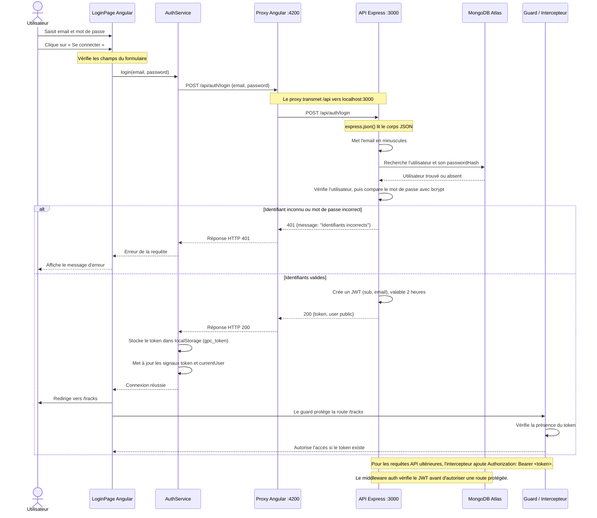

# Schéma annoté du flux de connexion

Le diagramme décrit la connexion par le formulaire Angular, la vérification des
identifiants par l'API Express et l'accès à la page des pistes.

## À retenir

- Le mot de passe est envoyé à l'API pour vérification, mais il n'est jamais
  stocké dans le navigateur ni inclus dans le JWT.
- La réponse de connexion contient le JWT et les données publiques de
  l'utilisateur; le hash du mot de passe n'est pas renvoyé.
- Une erreur réseau (API arrêtée ou inaccessible) n'est pas un refus
  d'identifiants : l'interface affiche alors son message générique « Erreur de
  connexion ».
- Le guard vérifie seulement que le token existe côté frontend. C'est le
  middleware backend qui valide réellement le JWT lors des requêtes protégées.

## Fichiers concernés

- `frontend-starter/src/app/components/login-page/login-page.ts`
- `frontend-starter/src/app/shared/services/auth.service.ts`
- `frontend-starter/src/app/shared/interceptors/auth.interceptor.ts`
- `frontend-starter/src/app/shared/guards/auth.guard.ts`
- `backend/src/app.js`
- `backend/src/server.js`